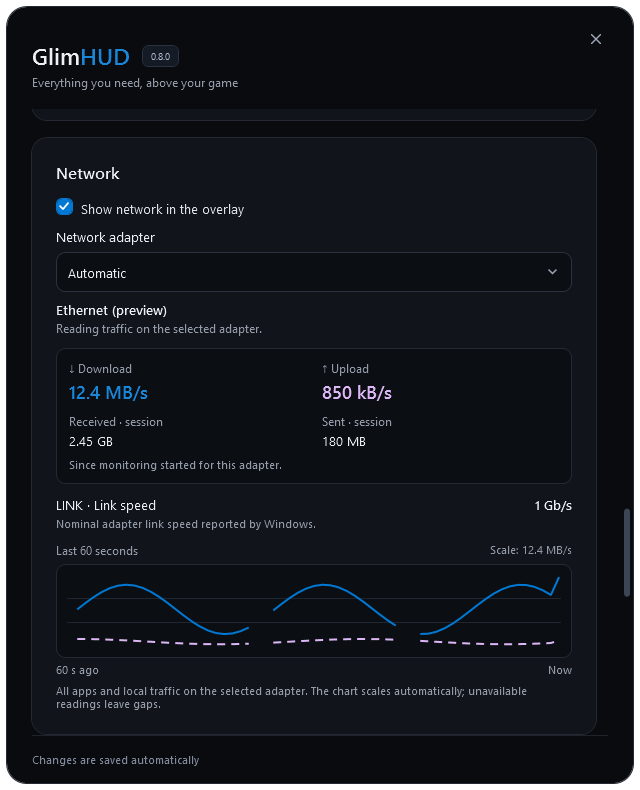

# GlimHUD

A transparent Windows overlay for music controls, FPS, CPU, GPU, memory, and network traffic. Built for windowed and borderless games, with no DLL injection into games.


*Design preview with sample measurements.*

**Windows 10 version 2004 or later / Windows 11 · x64 · .NET 10 · MIT**

[Product page](https://pyrrhuladev.github.io/GlimHUD/) · [Download installer](https://github.com/pyrrhuladev/GlimHUD/releases/latest/download/GlimHUD-Setup-x64.exe) · [Release notes](https://github.com/pyrrhuladev/GlimHUD/releases)

## Features

- Compact, movable overlay with a translucent background and readable controls.
- Optional compact layout with smaller text and spacing, hidden artwork and section icons; the regular layout remains available.
- Editable Classic, Capsule, Slate, Terminal, and Paper [themes](docs/themes.md): panel and card shapes, horizontal/vertical layout, module order, spacing, typography, colors, and optional controls. Import and export themes as JSON.
- Current track, artwork, previous/play/pause/next controls through Windows media sessions. Supports compatible players, including Yandex Music.
- Per-application music volume through WASAPI, with optional scrolling over the player area. It does not fall back to changing the system master volume.
- Presented FPS through PresentMon, CPU/GPU load and available temperatures, and physical memory usage.
- Optional network download/upload rates, adapter selection, session traffic totals, and a 60-second graph in Settings.
- Optional player hiding, automatic display while a recognized game is active, and manual game executable selection.
- Windows accent color or a custom color, adjustable scale, and click-through mode.
- Independent text/background colors with white, black and custom choices.
- Optional Rainbow Wave and Neon Flow styles with outer and inner glow, adjustable intensity, and music response, off by default.
- Dark matte Settings with consistent spacing and clear control states.
- Alignment guides during free dragging. A small release-only magnet aligns nearby grid lines, edges or centers; hold Shift to skip snapping. Disable guides in Settings if preferred.
- English by default, with Russian selectable in Settings.
- Per-user Windows installer and optional update checks, with installer and feed verification through NetSparkle's Ed25519 signatures.

## Download and use

Download the [Windows x64 installer](https://github.com/pyrrhuladev/GlimHUD/releases/latest/download/GlimHUD-Setup-x64.exe) from the [product page](https://pyrrhuladev.github.io/GlimHUD/). GlimHUD installs for your Windows account and includes the .NET runtime. An optional CPU-temperature driver task, selected by default when PawnIO is missing or older, can request administrator approval through Windows UAC for the bundled official PawnIO installer. Cancelling that request does not cancel the GlimHUD installation.

For a portable copy, download [GlimHUD-win-x64.zip](https://github.com/pyrrhuladev/GlimHUD/releases/latest/download/GlimHUD-win-x64.zip), extract the complete ZIP, and start `GlimHUD.exe`. Keep all extracted files together. Additional builds and checksums are available in [GitHub Releases](https://github.com/pyrrhuladev/GlimHUD/releases). Framework-dependent source builds require the [.NET 10 Desktop Runtime for x64](https://dotnet.microsoft.com/download/dotnet/10.0).

On the first launch, position the unlocked overlay, then use the tray menu or Settings to adjust its appearance and data sources.

**Request administrator access at startup** is enabled by default for unpackaged copies. GlimHUD asks Windows for elevation through UAC; approving restarts it with administrator access, while cancelling keeps it running normally. Disable this option in Settings to use normal launches. An already elevated process does not request elevation again. Administrator access can help with FPS capture and some hardware sensors, but does not guarantee every reading. Music controls and network counters do not require it. Packaged and diagnostic launches do not use this automatic request.

**Compact layout** is optional and saved in Settings. It reduces text sizes and spacing and hides album artwork, section icons, the mute button, and the volume slider. Previous/play/next controls, volume percentage, and selected metrics remain visible. Adjust volume by scrolling over the player if that option is enabled, or use the global volume/mute shortcuts. Turning compact layout off restores the regular layout.

**Themes** can change the panel's structure as well as its colors. Select a preset under Themes, then expand its customization controls to change its layout, corners, spacing, text, and decorative elements. Existing appearance and glow controls edit the same theme. Export a theme to share it, or import a theme JSON file to apply it immediately. Themes keep your enabled modules, device selections, panel position, language, and application behavior. See [the theme format and limits](docs/themes.md).

| Shortcut | Action |
| --- | --- |
| `Ctrl + Alt + G` | Toggle locked / interactive mode |
| `Ctrl + Alt + H` | Show / hide the overlay |
| `Ctrl + Alt + S` | Open Settings |
| `Ctrl + Alt + Space` | Play / pause music |
| `Ctrl + Alt + Left` | Previous track |
| `Ctrl + Alt + Right` | Next track |
| `Ctrl + Alt + Up` | Music volume +3% |
| `Ctrl + Alt + Down` | Music volume -3% |
| `Ctrl + Alt + M` | Mute / unmute music |

Music shortcuts work globally, including when the overlay is locked or hidden and when its player section is hidden. Volume shortcuts control the selected music application's audio sessions, not Windows master volume. Hold a volume shortcut to change it repeatedly. Playback, track and mute shortcuts trigger once per key press. Settings lists any shortcuts that Windows could not register because another application uses them or Windows blocks them.

Settings are saved locally at `%LOCALAPPDATA%\GlimHUD\settings.json`. Language changes apply immediately.

**Panel glow** in Settings offers two styles: **Rainbow Wave** keeps the flowing RGB rainbow, while **Neon Flow** adds cyan and pink neon with a bright white core. Both animate outside and inside the panel, beneath its background and text. The intensity slider controls the effect, and the selected style is saved across restarts. Existing settings keep Rainbow Wave.

Optional **React to music** follows the audio level of the application selected for music volume. Rises in that level add light pulses, traveling highlights, and halo expansion. **Music response sensitivity** makes quieter music trigger more readily as you raise it; this preference is saved independently of glow intensity and style. The live **Music signal** meter helps check whether the selected application's audio reaches the effect. The response fades during silence or when that session is unavailable, while the baseline animation continues. No artificial beat is generated when music is absent. It does not follow system-wide or game audio unless that application is selected. Glow is disabled by default.

**Support and ideas** at the bottom of Settings links to [GitHub Issues](https://github.com/pyrrhuladev/GlimHUD/issues) for bug reports and feature requests, and to the [repository](https://github.com/pyrrhuladev/GlimHUD). Each button opens your browser only when clicked; it does not send a report.

Optional **Start with Windows** is available in Settings. It registers the current executable for your Windows sign-in without administrator access. Keep a portable folder in place; after moving it, toggle the option off and on to update its location. Windows Startup apps settings can independently disable registered applications. The option is off until enabled and does not change Windows permissions. If the separate administrator-at-startup option is enabled, launching GlimHUD at sign-in can also show its UAC request.

**Network** in Settings lets you add download and upload rates to the HUD; this module is off by default. Automatic selection uses one connected physical Ethernet or Wi-Fi adapter, preferring the Windows IPv4 default-route metric and otherwise an adapter with a gateway. Select an adapter manually for VPN, virtual-switch, or multi-adapter setups. A manually selected adapter that disconnects is shown as unavailable until it returns.

The network settings show the selected adapter's live rates, received/sent totals for this app session, reported link speed, and a 60-second graph. Totals start from the first observation of each adapter in this process and survive switching adapters or reconnecting; Windows counter resets and unobservable intervals are skipped. Switching adapters starts a fresh graph while retaining each adapter's session totals. Closing GlimHUD clears these totals and history. Rates use decimal byte units such as kB/s and MB/s; link speed uses bits per second. Link speed is the adapter's reported connection rate, not an internet speed test. Adapter traffic includes all applications and local-network transfers; it is not a per-game or internet-only measurement.



*Network settings preview with sample measurements.*

**Updates** in Settings can check for a newer installed version, download it, and install it when you choose. Automatic checks can be disabled. Checks never install an update or restart the app by themselves. Both update metadata and downloaded installers must pass NetSparkle Ed25519 verification against the public key shipped with GlimHUD. Portable copies use manual updates through GitHub Releases.

When GlimHUD is elevated, a requested update is handed to the normal Explorer desktop for the same Windows account so the installer stays per-user. If that desktop is unavailable, elevated, or belongs to another account, GlimHUD does not launch the installer as administrator. Restart GlimHUD normally or download the installer from Releases and run it normally. Entering another account's credentials at UAC also runs the HUD with that account's separate settings and data locations.

Windows publisher signing (Authenticode) for GlimHUD is not configured yet, so Windows may show an unknown-publisher or SmartScreen warning. The bundled official PawnIO installer retains its vendor's own digital signature. Update signatures authenticate project updates; they do not provide a verified Windows publisher identity for GlimHUD. There is no published Microsoft Store listing. See [distribution and release setup](docs/distribution.md) for the website, installer, and update pipeline, or [Microsoft Store preparation](docs/microsoft-store.md) for the separate MSIX work.

## Data sources and limits

Music comes from Windows Global System Media Transport Controls. Metadata and artwork depend on what each player exposes. Playing music sessions are preferred over stale paused sessions, and a source can be selected manually in Settings. Volume targets the matching application's Windows audio sessions; select an application manually if automatic matching is ambiguous.

CPU usage uses Windows Processor Utility, which accounts for clock speed and boost and can exceed 100%. If that counter is unavailable, GlimHUD falls back to CPU busy time. GPU usage takes the busiest graphics engine or vendor core reading, whichever is higher, for the selected adapter. CPU/GPU/RAM sampling runs once per second independently of media and artwork loading. This follows the measurement definitions described by [Valve](https://help.steampowered.com/en/faqs/view/3462-CD4C-36BD-5767); different sampling times and adapter selections can still produce different readings.

RAM and performance counters have native Windows data sources. Optional temperature sensors use LibreHardwareMonitor; available readings depend on hardware, drivers, and permissions. An unavailable measurement is shown as a dash. The startup administrator option uses the normal Windows UAC prompt and never changes Windows security policy or group membership.

**CPU temperature** through LibreHardwareMonitorLib 0.9.6 needs low-level access through the separate PawnIO driver. Both the GlimHUD installer and portable ZIP include the unchanged, digitally signed official PawnIO 2.2.0 installer, so no second download is needed. The optional driver task installs missing or known older versions; an installed version of 2.2 or newer is kept. An existing installation whose version cannot be established is left unchanged to avoid a downgrade.

Portable users and existing installations can use the PawnIO install action in Settings to start the bundled official installer with Windows UAC approval. If approval is cancelled or installation fails, GlimHUD continues to work while CPU temperature may remain unavailable. A successful driver installation can require a Windows restart; GlimHUD never restarts Windows automatically. Relaunch GlimHUD after any required restart. It can also retry sensor initialization when previously unavailable driver access becomes available. Settings retains an [official PawnIO website](https://pawnio.eu/) help link.

A supported CPU such as the Intel Core i5-10400F can show normal CPU load while its temperature is unavailable because the driver is missing or inaccessible. Administrator access alone does not supply a missing driver, and a successful driver installation does not guarantee a sensor reading. Settings distinguishes missing PawnIO, denied or unavailable device access, and a sensor that still has no reading. The unsigned developer edition and Windows security-policy changes are not needed. PawnIO is a system component shared with other applications and remains installed when GlimHUD is removed; manage it separately in Windows Installed apps. Its official installer has separate [redistribution terms](THIRD-PARTY-NOTICES.md); the [open-source driver project](https://github.com/namazso/PawnIO) and the library's hardware-access modules retain their own licenses.

Network readings use local Windows interface counters sampled about once per second, with rates calculated from byte-counter differences and actual elapsed time. GlimHUD measures one selected adapter at a time rather than adding physical and VPN traffic together. It does not capture packets, inspect their destinations or payloads, send probes, or require administrator access for this module. The 60-second history stays in memory; disconnected or invalid intervals appear as gaps. Network-interface and driver limitations can make a reading unavailable.

FPS uses [PresentMon](https://github.com/GameTechDev/PresentMon) to count presented frames. This is not the display refresh rate or the overlay's own frame rate. ETW capture can require additional permissions. The startup UAC request can provide them; Settings also offers an administrator restart when access is denied. Cancelling a UAC prompt keeps the current app running. The other overlay features work when FPS capture is unavailable. Choose a game manually when automatic process selection is unsuitable.

In automatic mode, brief focus changes to known recording-control windows keep the selected game as the FPS target. Recording helpers are excluded from the frame stream so their own low frame rate does not replace the game's reading. An expired game stream still becomes unavailable; GlimHUD does not invent or smooth a replacement FPS value. This does not guarantee that recording cannot reduce a game's actual performance.

For troubleshooting, **Copy diagnostics** in Settings generates a bounded local JSON report and copies it to your clipboard only when clicked. It includes CPU temperature/access information and FPS target, frame age, swapchain, and collector status, plus app/OS/permission context. It excludes media information, window titles, file paths, network identifiers, and serial numbers. Review the report before choosing to paste it into a GitHub issue; GlimHUD does not upload it.

Game-only display is optional. Recognition uses known game installation paths and exact executable paths selected by the user; browsers and launchers are excluded where identifiable. Windowed and borderless modes are the intended targets. Exclusive fullscreen and individual anti-cheat systems need separate compatibility testing.

See the [privacy policy](docs/privacy-policy.md) for local data handling.

## Build from source

Install the [.NET 10 SDK for Windows x64](https://dotnet.microsoft.com/download/dotnet/10.0). A Desktop Runtime alone cannot build the project. Scripts also recognize an SDK extracted into `.tools\dotnet`. The project targets Windows SDK contracts for Windows 10 19041; the .NET restore supplies the targeting references. A separate Windows SDK installation is needed for [MSIX packaging](docs/microsoft-store.md), not a normal portable build.

```powershell
.\scripts\Get-PresentMon.ps1
.\scripts\Get-PawnIO.ps1
.\scripts\Build.ps1
.\scripts\Test.ps1
.\scripts\Publish.ps1 -SelfContained
```

Published files are written to `artifacts\GlimHUD-win-x64`. Keep all files in that directory together. PresentMon 2.6.0 is downloaded from its official upstream release and checked against its SHA-256 digest. It can be omitted for a build without FPS capture. `Get-PawnIO.ps1` fetches the pinned official PawnIO 2.2.0 installer, checks its size, SHA-256, valid Authenticode signature and pinned signer, and writes provenance for packaging. It does not run the installer. Release packages require this complete unchanged installer and its notices.

To build the optional installer, run `scripts/Get-InnoSetup.ps1`, then `scripts/Build-Installer.ps1 -InputDirectory artifacts/GlimHUD-win-x64`. This compiles the installer without installing or starting it. Release automation and signing-key setup are documented in [distribution.md](docs/distribution.md).

To restore and build the complete solution, including check projects:

```powershell
dotnet restore .\GlimHUD.slnx
dotnet build .\GlimHUD.slnx --configuration Release --no-restore
.\scripts\Test.ps1 -NoRestore -NoBuild
```

The console check projects cover media selection, artwork caching, audio targeting, FPS aggregation, telemetry, settings, input gating, accents, and localization. Normal checks do not change another application's playback or volume. Python 3 runs the release archive fixture checks. Hardware availability is handled by the relevant checks; real game/player compatibility still needs a manual check on Windows.

## Contributing and license

Issues, pull requests, and repository documentation use English. See [CONTRIBUTING.md](CONTRIBUTING.md) and [SECURITY.md](SECURITY.md).

GlimHUD's original code and project assets use the [MIT license](LICENSE). Bundled dependencies retain their own licenses; see [THIRD-PARTY-NOTICES.md](THIRD-PARTY-NOTICES.md) and the accompanying license files.
