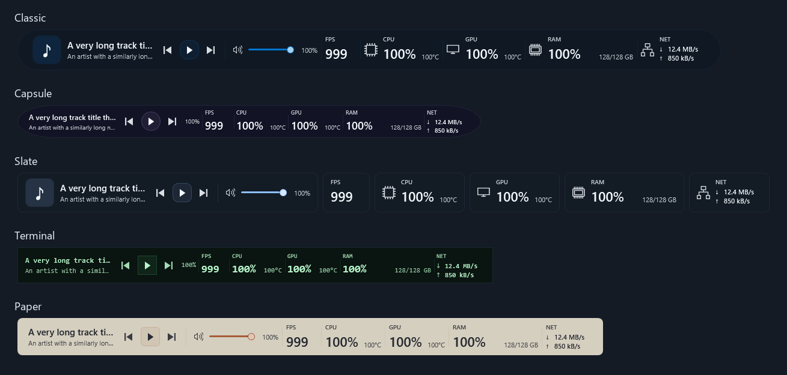

# HUD themes

Themes change GlimHUD's panel layout, geometry, typography, colors, and decorative elements. Settings applies changes immediately; a restart is unnecessary.

*Application renders with sample measurements.*

## Using themes

Choose **Settings → Themes** and select a built-in preset:

| Preset | Appearance |
| --- | --- |
| Classic | The original rounded panel and music controls. |
| Capsule | A short, rounded strip with fewer decorative elements. |
| Slate | Separate module cards with space between them. |
| Terminal | Square corners, a monospace font, and restrained styling. |
| Paper | A light surface with dark text. |

Customize a preset using the theme controls. Existing accent, foreground/background, opacity, compact-layout, and glow controls edit that theme too. Select a preset again to restore its defaults, or use **Reset** to return to Classic. Enabled modules and the adapter/player selections are independent of the theme.

An installation upgraded from an older version keeps its appearance until a theme is selected. Its old settings can also be exported as a theme.

## What a theme controls

- One shared panel or separate module cards; horizontal or vertical layout.
- Module order, panel and card corner radii, border width, content height, padding, and spacing.
- Font family and label, value, and secondary text sizes.
- Visibility of decorative icons, labels, artwork, dividers, and the volume slider.
- Text, background, and accent colors; background opacity and Windows accent selection.
- Compact layout and glow preferences, including music response and sensitivity.

Hiding the volume slider retains the volume percentage, music-wheel adjustment when enabled, and global volume shortcuts. Playback buttons remain available. A theme cannot change the devices used for measurements or enable unavailable readings.

Unified panels reuse the cached bitmap glow renderer and follow the chosen corner radius. Separate cards suppress the single-panel glow envelope; the selected glow preferences are retained for switching back to a shared panel. No extra animation runs while glow is suppressed.

## Sharing themes

Use **Export** to save the current appearance as a JSON file. Use **Import** to select and apply a JSON theme. Invalid files leave the current theme intact. Reset restores Classic; custom files can be saved again under a new name.

Theme files contain appearance data, with a versioned schema and a maximum input size of 256 KiB. Dimensions and numeric settings are normalized to supported ranges; invalid color/font values use safe defaults. Unknown fields and unsupported schema versions are rejected. Themes contain no executable code, XAML, images, external URLs, or font downloads.

Themes do not export or change panel position, display scale, enabled modules, media/audio/GPU/network selections, game paths, lock state, hotkeys, startup behavior, administrator requests, language, or update preferences.

## JSON format

Start from a complete sample: [Classic](themes/classic.glimtheme.json), [Capsule](themes/capsule.glimtheme.json), [Slate](themes/slate.glimtheme.json), [Terminal](themes/terminal.glimtheme.json), or [Paper](themes/paper.glimtheme.json). The application also accepts `.json` files without the `.glimtheme` suffix.

Sizes use device-independent pixels before the separate panel scale. A large font can expand the content area enough to keep its text legible. Compact mode reduces theme sizes and hides artwork, decorative icons, and the volume slider.

| Fields | Accepted values |
| --- | --- |
| `schemaVersion` | Required integer `1`. |
| `id`, `name` | Stable identifier and display name. Names are limited to 64 characters. |
| `layout`, `orientation` | `bar` or `cards`; `horizontal` or `vertical`. |
| `moduleOrder` | Ordered module IDs: `music`, `fps`, `cpu`, `gpu`, `ram`, `network`. Duplicates and unknown IDs are removed; missing modules are appended. Visibility remains an application preference. |
| `cornerRadius`, `moduleCornerRadius` | Panel radius 0–100; card/control radius 0–50. |
| `borderThickness`, `contentHeight` | Border 0–4; minimum content height 28–80. |
| `paddingHorizontal`, `paddingVertical`, `moduleGap` | Horizontal padding 0–40; vertical padding 0–24; gap 0–32. |
| `fontFamily` | Local family name, such as `Segoe UI` or `Consolas`; no file paths or font URLs. |
| `valueFontSize`, `labelFontSize`, `secondaryFontSize` | 10–32, 8–16, and 8–20 respectively. |
| `showIcons`, `showLabels`, `showArtwork`, `showVolumeSlider`, `showDividers`, `compactMode` | Booleans. |
| `textColor`, `backgroundColor`, `accentColor` | `#RRGGBB`. |
| `backgroundOpacity`, `useWindowsAccent` | Opacity 0.05–0.85; boolean for the live Windows accent. |
| `glowEnabled`, `glowReactive`, `glowStyle` | Booleans and `rainbow-wave` or `neon-flow`. |
| `glowIntensity`, `glowSensitivity` | 0–1. |

## Validation

`GlimHUD.ThemeChecks` exercises theme round trips, normalization, old-settings compatibility, and preservation of application preferences. The diagnostic theme smoke run also exercises actual WPF layout and live switching with sample values and without starting hardware capture, media commands, updates, global hooks, or UAC.
